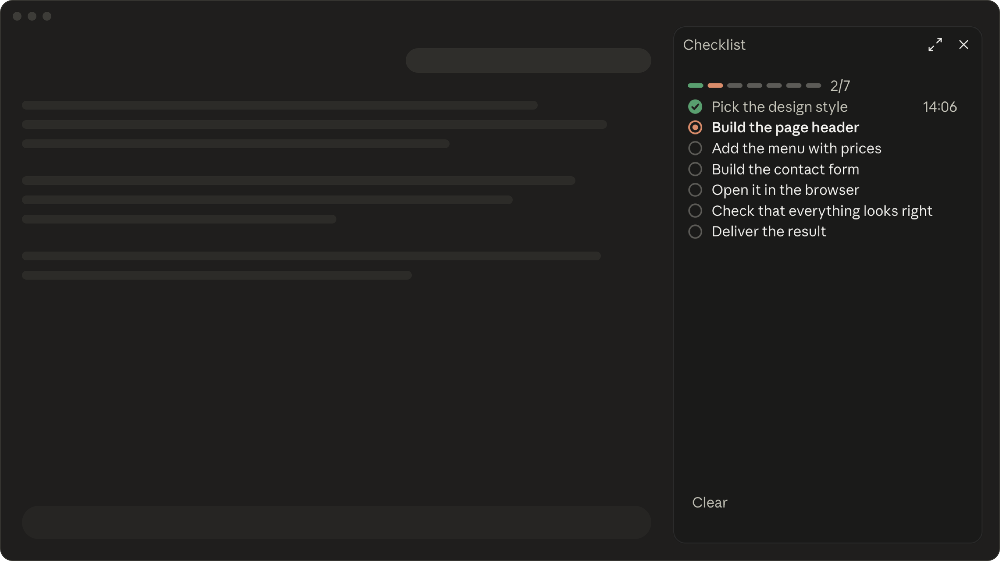
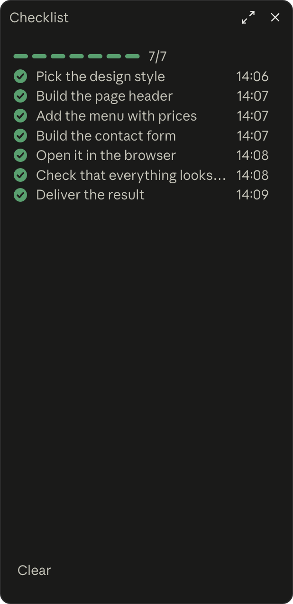

🇬🇧 [English](README.md)

# nix checklist-sidebar

**Claudes Plan als Checkliste – in einfacher Sprache, in einer schmalen Leiste rechts.**



## Das Problem

Claude arbeitet oft minutenlang: liest Dateien, schreibt Code, sucht im Netz. Was es gerade vorhat und was schon fertig ist, steckt irgendwo im Chat – in Fachsprache, zwischen Befehlen und Code. Wer nicht programmiert, verliert schnell den Überblick.

## Die Lösung

Eine schmale Leiste rechts zeigt Claudes Plan als Checkliste in Alltagssprache – live abgehakt, mit Uhrzeiten. Gestaltet, um sich in Claude einzufügen: Claudes eigene Farben, Dark Mode, keine wilden Farben – clean und minimal.

## Installieren

1. Claude Code öffnen (Desktop-App oder Terminal).
2. Ins Eingabefeld schreiben und Enter drücken:
   ```
   /plugin marketplace add nikscz/nix-checklist-sidebar
   ```
3. Dann:
   ```
   /plugin install nix-checklist-sidebar@nix-checklist-sidebar
   ```
4. Claude Code einmal neu starten (oder `/reload-plugins` eingeben). Fertig.

Kein GitHub-Konto nötig.

## So geht’s

- Ab zwei Arbeitsschritten legt Claude die Liste **immer** an. Vergisst es das, wird es erinnert.
- Erledigt: grüner Haken und **Uhrzeit**. Gerade dran: oranger Ring. Offen: grauer Kreis.
  Oben zeigen kleine Pills den Stand, z. B. 3/6.
- Letzter Schritt ist immer **„Ergebnis ausgeben“** – abgehakt, sobald die Antwort fertig ist.
- Frühere Aufgaben bleiben als Protokoll stehen, bis du **Leeren** drückst.
- **Keine Dateien:** Die Liste lebt nur im jeweiligen Chat.
- Die Leiste folgt deiner Systemsprache (Deutsch oder Englisch) – oder einer Sprache, die du festlegst; Claude schreibt die Schritte in deiner Sprache.

| Befehl | Was passiert |
|---|---|
| `/nix-checklist-sidebar` | öffnet die Leiste jederzeit wieder |
| `/nix-checklist-sidebar english` / `deutsch` | feste Sprache für die Leiste |
| `/nix-checklist-sidebar auto` | folgt wieder der Systemsprache |

### Add-on: nix-progress-bar

Mit [nix-progress-bar](https://github.com/nikscz/nix-progress-bar) dazu zeigt auch der Balken über
dem Eingabefeld die Schritte als Pills – und schätzt, wie lange Claude noch braucht.

## Screenshots



Zusammen mit dem Add-on [nix-progress-bar](https://github.com/nikscz/nix-progress-bar):


> [!WARNING]
> **Frühe Version – Updates kommen.** Diese Art Erweiterung ist bei Claude Code noch ganz neu.
> Nach einem Update von Anthropic kann etwas nicht mehr funktionieren, bis hier ein Fix kommt.
> Mit automatischen Updates (unten) bekommst du ihn von selbst.

## Updates

Einmal einschalten und vergessen: `/plugin` eingeben → **Marketplaces** → **nix-checklist-sidebar** →
automatische Updates an.

Oder von Hand, wann immer du willst:
```
/plugin marketplace update nix-checklist-sidebar
```

### Neu

**2.2 – Deutsch und Englisch.** Die festen Wörter des Tools folgen deiner Systemsprache: Deutsch auf
einem deutschen System, sonst Englisch – oder du wählst selbst mit `/nix-checklist-sidebar english`, `deutsch`
oder `auto`. Andere Sprachen (z. B. Spanisch) bekommen die englischen Wörter – alles, was Claude
selbst schreibt (die Schritte, der Danke-Satz, die Antworten), kommt aber ohnehin in deiner Sprache.

## Deinstallieren

```
/plugin uninstall nix-checklist-sidebar@nix-checklist-sidebar
```

## Mehr von nikscz

- [nix-progress-bar](https://github.com/nikscz/nix-progress-bar) – Fortschrittsleiste mit Zeitschätzung
- [nix-note](https://github.com/nikscz/nix-note) – Projekt-Notizen nebenbei mit /note
- [nix-done-sound](https://github.com/nikscz/nix-done-sound) – dein eigener Alert-Sound, wenn Claude fertig ist

## Lizenz

[MIT](LICENSE) – nutzen, ändern, weitergeben erlaubt, ohne Gewähr.

Mit Claudius, für Claudius. Fehler gefunden oder eine Idee?
Gern ein [Issue](https://github.com/nikscz/nix-checklist-sidebar/issues) aufmachen.
